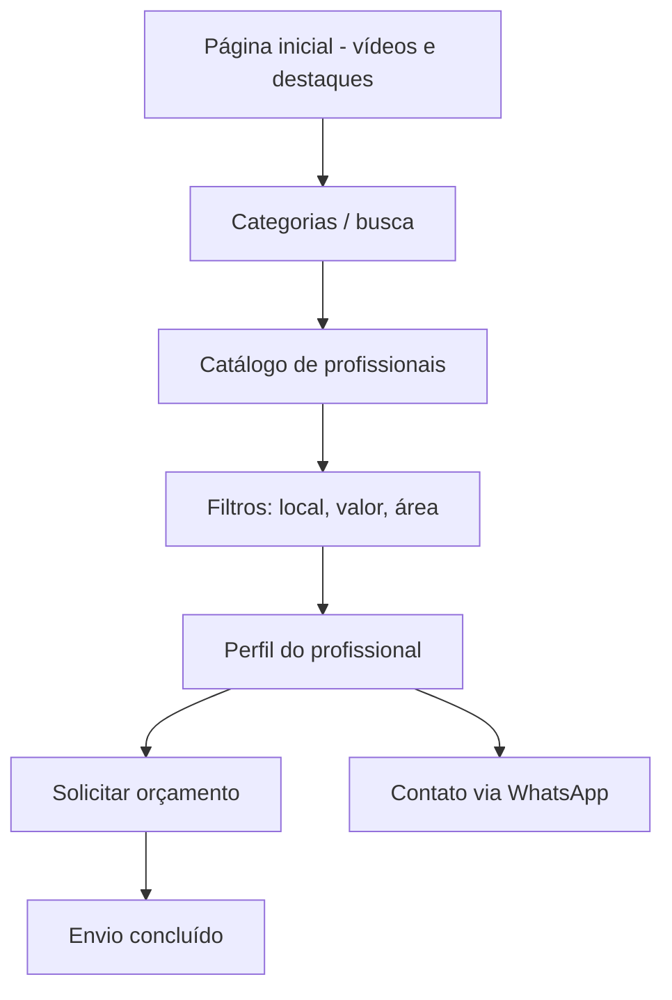

# Documentação Consolidada — Manutenção e Serviços

> **Consolidação de fontes**
>
> Este documento unifica as informações de três fontes:
>
> 1. `chat-Respostas em Português BR.md` — documentação técnica gerada em chat (versão A).
> 2. `Respostas gemini.pdf` — resposta do Gemini à mesma solicitação, com diretrizes de assistente (versão B).
> 3. Skill `using-superpowers` — diretrizes de trabalho/orquestração de agentes (apêndice).
>
> Onde as duas versões da documentação divergem, a divergência é registrada explicitamente e uma recomendação é indicada. Itens não confirmados são marcados com **[A confirmar]** ou **[Informação ausente]**.

---

## 1. Visão Geral do Produto

### 1.1 Nome do site

**Manutenção e Serviços**. A ideia original mencionava "manutenção e serviços. www"; o trecho ". www" pode ser uma referência incompleta a domínio/endereço. **[A confirmar]** o nome final do domínio.

### 1.2 Descrição da ideia

O site **Manutenção e Serviços** é uma plataforma que atua como um **catálogo digital** para conectar clientes a profissionais de serviços gerais/manutenção. O sistema organiza os prestadores de serviço por áreas de atuação e disponibiliza seus portfólios, referências e avaliações, facilitando o contato direto para orçamentos.

A proposta é reunir profissionais que realizam serviços de manutenção, consertos, reformas e outros serviços gerais, organizando-os por categoria de atuação, em **Serra dos Aimorés**. O usuário encontra prestadores, visualiza portfólio, referências, recomendações e críticas, e entra em contato para solicitar orçamento.

### 1.3 Problema real identificado

Dificuldade que as pessoas têm para encontrar profissionais confiáveis para serviços de manutenção em residências, conserto de eletrodomésticos, computadores, celulares, reformas, construções e outros serviços em geral. Soma-se a isso a falta de referências claras: o cliente não sabe avaliar previamente a qualidade do serviço, não conhece trabalhos anteriores e não possui um canal simples para conversar com o profissional ou pedir orçamento.

### 1.4 Público-alvo

- **Quem são:** pessoas localizadas na região de Serra dos Aimorés que precisam de reformas, construções, conserto de computadores, celulares e eletrodomésticos, manutenção em geral.
- **O que precisam:** encontrar profissionais por tipo de serviço; ver referências e trabalhos anteriores; comparar opções; entrar em contato; solicitar orçamento de forma direta.
- **Dificuldades:** encontrar profissionais qualificados; falta de referências confiáveis; desorganização das informações; ausência de canal simples de contato/orçamento; insegurança na contratação.
- **O que esperam:** catálogo organizado por categorias; informações claras sobre cada profissional; portfólio; avaliações/recomendações/referências; filtro por localidade, categoria e possivelmente valor; contato fácil.

### 1.5 Proposta de valor

Centralizar profissionais de manutenção e serviços em um único lugar, facilitando a busca por prestadores confiáveis. Em vez de procurar indicações de forma dispersa, o usuário acessa um catálogo organizado, vê portfólios, referências e recomendações, e entra em contato com mais segurança.

> **Proposta de valor:** facilitar a conexão entre pessoas que precisam de serviços de manutenção e profissionais capacitados, organizando informações e aumentando a confiança na contratação.

### 1.6 Objetivos do site

- Divulgar profissionais de manutenção e serviços gerais.
- Organizar prestadores por categorias de atuação.
- Facilitar a busca por serviços em Serra dos Aimorés.
- Apresentar portfólios e referências dos profissionais.
- Permitir contato entre cliente e profissional.
- Facilitar pedidos de orçamento.
- Aumentar a visibilidade de prestadores de serviço locais.
- Reduzir a insegurança na contratação.

### 1.7 Funcionalidades principais

| Funcionalidade | Finalidade | Prioridade |
|---|---|---|
| Catálogo de profissionais | Listar profissionais cadastrados conforme a área de atuação | Essencial |
| Categorias/Abas de serviços | Organizar profissionais por tipo de serviço (manutenção, conserto, reforma, construção) | Essencial |
| Filtros de busca | Filtrar por localidade (Serra dos Aimorés), categoria e valor | Essencial |
| Perfil do profissional | Informações, área de atuação, portfólio, referências, recomendações, críticas | Essencial |
| Portfólio de serviços | Mostrar trabalhos realizados | Essencial |
| Sistema de avaliações/referências | Exibir referências, recomendações e críticas | Essencial/Importante |
| Depoimentos em vídeo | Vídeos de clientes indicando serviços prestados | Importante |
| Contato direto / pedido de orçamento | Formulário/tabela direcionada para orçamento do serviço | Essencial |
| Chat privado | Conversa direta dentro da plataforma | Futura (MVP simplificado para WhatsApp/formulário) |
| Cadastro de profissionais | Registrar profissionais e áreas de atuação | Importante/Futura |

**Observação (consenso das duas versões):** o chat privado em tempo real (sockets) é complexo. Para o MVP, recomenda-se usar **formulário de contato/orçamento e/ou botão de WhatsApp**, deixando o chat como evolução futura.

### 1.8 Diferencial do site

Acesso direto ao profissional aliado a um histórico transparente de informações, referências e dados categorizados por área de atuação. Reúne profissionais em um único local, facilita a comparação entre prestadores, mostra portfólios e referências, dá mais transparência à contratação e aproxima clientes e profissionais da região.

### 1.9 Conteúdo da página inicial

- Título principal apresentando o site.
- Breve explicação sobre a proposta.
- Campo/botão de busca por profissionais.
- Categorias de serviços (abas).
- Profissionais em destaque.
- Portfólios de serviços prestados.
- Referências e recomendações de clientes.
- Depoimentos em vídeo (destaque visual adequado).
- Chamada para ação ("Encontrar profissional", "Solicitar orçamento").
- Rodapé com contato, aviso de privacidade e links principais.

**Sugestão técnica (consenso):** destacar a cidade **Serra dos Aimorés** logo na página inicial, deixando claro que o serviço é voltado para aquela região.

### 1.10 Premissas, lacunas e decisões de escopo

**Informações fornecidas:** nome do site; problema; público-alvo; funcionamento geral; funcionalidades principais; diferencial; benefícios; conteúdo da home.

**Informações ausentes/vagas (lacunas):**
- Nome exato do domínio / se ". www" faz parte do nome final. **[A confirmar]**
- Como será feito o cadastro dos profissionais (autônomo ou com aprovação). **[Informação ausente]**
- Se profissionais terão autonomia para editar seus próprios perfis. **[Informação ausente]**
- Como recomendações e críticas serão moderadas/verificadas. **[Informação ausente]**
- Quais campos farão parte da tabela de orçamento. **[A confirmar]**
- Se haverá filtro por faixa de valor e como esse valor será definido. **[A confirmar]**
- Se haverá login para clientes e profissionais. **[Informação ausente]**
- Se o site terá pagamento integrado. **[Informação ausente]**
- Se o chat privado será em tempo real ou troca simples de mensagens. **[A confirmar]**
- Como os profissionais serão verificados antes de entrar no catálogo. **[A confirmar]**

**Premissas assumidas:**
- MVP focado em catálogo público de profissionais, com páginas de perfil e contato/orçamento.
- Chat privado em tempo real não implementado na primeira versão.
- Cadastro inicial dos profissionais de forma simplificada, sem painel administrativo completo.
- Site inicialmente voltado para Serra dos Aimorés e região.
- Contato por formulário e/ou botão de WhatsApp, conforme informação disponibilizada pelo profissional.
- Foco inicial na região de Serra dos Aimorés, com possibilidade de expansão futura.

**Sugestões técnicas adicionadas (consenso):**
- Usar formulário de orçamento em vez de chat privado no MVP.
- Usar vídeos externos (YouTube/Vimeo) para reduzir armazenamento próprio.
- Validar todos os dados enviados por formulários.
- Exibir mensagens claras de sucesso e erro.
- Incluir aviso de privacidade quando houver coleta de dados de contato.
- Moderar "críticas e avaliações" no banco para evitar ofensas públicas não moderadas.
- Validar formulários para impedir spam nos pedidos de orçamento.

**Fora do escopo (MVP):** pagamento online; app mobile nativo; painel administrativo completo; chat em tempo real (sockets); IA complexa; relatórios avançados; sistema financeiro; múltiplos bancos de dados; microserviços; blockchain.

---

## 2. Arquitetura da Informação

### 2.1 Mapa de páginas (unificado)

| Página | Rota sugerida | Objetivo | Público principal | Conteúdo principal | Ações do usuário | Prioridade |
|---|---|---|---|---|---|---|
| Início | `/` | Apresentar a plataforma e gerar confiança | Todos | Vídeos em destaque, categorias, melhores portfólios, referências | Buscar profissional, acessar categorias | Essencial |
| Catálogo de profissionais | `/profissionais` | Listar prestadores de serviço | Clientes | Lista de profissionais, filtros (local, valor, área) | Filtrar, ordenar, abrir perfil | Essencial |
| Perfil do profissional | `/profissionais/[id]` | Detalhar um profissional | Clientes | Foto/logo, descrição, categoria, portfólio, referências/críticas, botão de contato | Ver portfólio, ler avaliações, solicitar orçamento | Essencial |
| Contato e orçamento | `/orcamento` (ou `/orcamento/[id]`) | Captar dados do serviço a ser feito | Clientes | Formulário/tabela estruturada com detalhes da necessidade | Preencher e enviar | Essencial |
| Como funciona | `/como-funciona` | Explicar o uso do site | Visitantes | Passo a passo para encontrar profissional e solicitar orçamento | Entender o funcionamento | Importante |
| Cadastro de profissional | `/cadastro-profissional` | Permitir que profissionais manifestem interesse em participar | Profissionais | Formulário simples com dados básicos | Enviar dados para avaliação/cadastro | Futura |

### 2.2 Fluxo principal de navegação (unificado)

1. O usuário acessa a página inicial e vê os depoimentos em vídeo.
2. Entende a proposta do site.
3. Busca por uma categoria ou profissional (abas de categorias).
4. Na página de catálogo, filtra por "Serra dos Aimorés" e avalia os profissionais listados.
5. Visualiza a lista de profissionais.
6. Abre o perfil de um profissional.
7. Analisa o portfólio e as recomendações/críticas.
8. Clica no botão de orçamento e preenche as informações ou é redirecionado para falar com o profissional (WhatsApp).
9. Recebe confirmação de envio.



### 2.3 Organização do conteúdo

- **Institucional:** apresentação do site; como funciona; contato; aviso de privacidade; região atendida.
- **Profissionais e serviços:** cadastros categorizados (reformadores, técnicos de PC, etc.); nome; categoria; descrição; cidade/bairro; foto/logo; contato.
- **Mídia comprobatória:** fotos dos trabalhos (portfólio); depoimentos em vídeo.
- **Reputação:** bloco de texto com críticas e elogios estruturados (referências, recomendações, avaliações).
- **Busca e filtros:** categoria do serviço; localidade (Serra dos Aimorés); faixa de valor; ordem de exibição.
- **Contato/orçamento:** nome do cliente; telefone/WhatsApp; e-mail (se necessário); descrição do serviço; profissional selecionado; mensagem/observações.

### 2.4 Estados e mensagens importantes

| Estado | Mensagem/comportamento recomendado |
|---|---|
| Formulário enviado com sucesso | "Seu pedido de orçamento foi enviado com sucesso." / "Orçamento enviado com sucesso. O profissional entrará em contato." |
| Erro ao enviar formulário | "Não foi possível enviar sua solicitação. Tente novamente." |
| Campo obrigatório não preenchido | "Preencha este campo antes de continuar." / "Por favor, preencha todos os dados na tabela de orçamento." |
| Nenhum profissional encontrado | "Nenhum profissional encontrado para essa busca/filtro. Tente outro filtro." / "Nenhum profissional encontrado para este filtro em Serra dos Aimorés." |
| Página em carregamento | Indicador visual de carregamento |
| Perfil indisponível | "Profissional não encontrado ou indisponível." |
| Imagem indisponível | Imagem alternativa padrão |
| Vídeo indisponível | Aviso ou esconder o bloco do vídeo |
| WhatsApp indisponível | Alternativa de formulário |

### 2.5 Requisitos de experiência do usuário

- Navegação simples e clara; abas visíveis para separar os tipos de serviços.
- Botões visíveis para "Buscar profissional" e "Solicitar orçamento".
- Textos objetivos e fáceis de entender.
- Layout responsivo para celular, tablet e computador (muita gente buscará por serviços via celular).
- Boa hierarquia visual, destacando informações importantes; vídeos e imagens de portfólio no topo.
- Informações principais acima da dobra.
- Filtros acessíveis (sidebar ou barra superior fixa para filtro de local e valor).
- Cartões de profissionais com informações resumidas.
- Formulários curtos.
- Acessibilidade básica: bom contraste, rótulos nos campos, textos alternativos em imagens.
- Mensagens de erro claras; feedback visual após ações.
- Confiança visual: vídeos e imagens de portfólio devem carregar rápido.

---

## 3. Stack Tecnológica Sugerida

### 3.1 Critérios de escolha

Simplicidade para alunos iniciantes; facilidade de aprendizado; baixo custo inicial; facilidade de publicação; manutenção simples; adequação ao escopo; possibilidade de evolução; tecnologias consolidadas com boa documentação. A plataforma exige cadastro de entidades, portfólios dinâmicos, filtros de busca por valor/região e avaliações, então é necessário um banco de dados.

### 3.2 Recomendação principal (comparativo das duas versões)

| Camada | Versão A (chat) | Versão B (Gemini) | Recomendação consolidada |
|---|---|---|---|
| Frontend | Next.js | React / Next.js | **Next.js** (App Router) |
| Estilo | CSS puro | Tailwind CSS | **Tailwind CSS** para velocidade; CSS puro é aceitável para aprendizado de fundamentos |
| Backend/DB | Supabase (PostgreSQL) | Supabase (PostgreSQL) | **Supabase** |
| Autenticação | Sem auth no MVP; Supabase Auth como evolução | (não detalhado) | Sem auth no MVP |
| Hospedagem | Vercel | Vercel | **Vercel** |
| Formulário/contato | Formulário próprio salvando no Supabase e/ou WhatsApp | Link de WhatsApp via API simples | Formulário + link de WhatsApp |
| Versionamento | Git e GitHub | GitHub | Git e GitHub |

**Divergência registrada:** versão A sugere CSS puro; versão B sugere Tailwind CSS. Recomendação: Tailwind CSS para agilidade, mas CSS puro é válido se o objetivo pedagógico for aprender fundamentos de layout. Decisão final **[A confirmar]** conforme preferência do aluno/equipe.

### 3.3 Diretrizes de stack conforme complexidade

- Criar site com catálogo dinâmico de profissionais.
- Usar banco de dados para armazenar profissionais, categorias, portfólios e pedidos de orçamento.
- Não implementar pagamento online nesta fase.
- Não implementar chat em tempo real no MVP.
- Não criar painel administrativo complexo inicialmente.
- Usar formulário simples para contato/orçamento.
- Permitir contato direto por WhatsApp, quando o profissional disponibilizar.
- Deixar login, área do profissional e chat privado como evoluções futuras.
- O formulário de orçamento pode apenas disparar uma mensagem direta para o WhatsApp do profissional usando uma API de links simples, eliminando a necessidade de um backend complexo de mensagens no início.

### 3.4 O que evitar

- Microserviços; Docker/Kubernetes; múltiplos bancos de dados; GraphQL se API simples for suficiente; infraestrutura complexa; soluções corporativas pesadas; app mobile nativo (site responsivo resolve o MVP); blockchain; IA complexa; payment gateway sem necessidade; chat em tempo real antes de validar a versão básica.

### 3.5 Serviços e integrações

| Serviço | Uso no projeto |
|---|---|
| WhatsApp | Contato direto com o profissional (API de redirecionamento) |
| Supabase Storage | Armazenar imagens de perfil e fotos de portfólio |
| YouTube ou Vimeo | Incorporar vídeos de depoimentos sem pesar o banco |
| E-mail | Confirmações/notificações futuras |
| Formulário de contato | Registrar pedidos de orçamento ou solicitações de cadastro |
| Mapa | Futuramente, para mostrar localização/área de atendimento |
| Autenticação | Futuramente, se houver área do profissional |

### 3.6 Hospedagem e deploy

- **Vercel** para hospedagem do frontend Next.js.
- **Supabase** para banco de dados, armazenamento e eventuais serviços de backend.
- Alternativas futuras: Netlify (frontend estático), Render/Railway (backend Node.js/Express separado).
- Para o MVP, **Vercel + Supabase** é a combinação mais simples e coerente.

### 3.7 Segurança e boas práticas mínimas

- Validar dados no frontend e no backend.
- Não expor chaves de API no código visível ao usuário.
- Usar HTTPS.
- Limitar a coleta de dados ao mínimo necessário.
- Exibir mensagens claras de erro.
- Proteger formulários contra envio indevido (spam).
- Não permitir que qualquer usuário edite dados de profissionais sem permissão.
- Usar políticas de segurança no Supabase (Row Level Security), quando aplicável.
- Cuidado com exibição pública de telefone, WhatsApp e imagens.
- Solicitar consentimento para uso de depoimentos e imagens.
- Incluir aviso simples de privacidade se o site coletar nome, telefone ou mensagens.
- Moderar "críticas e avaliações" no banco para evitar ofensas públicas não moderadas.

---

## 4. Estrutura de Pastas e Boas Práticas

### 4.1 Estrutura de pastas sugerida (unificada, Next.js App Router)

```
projeto/
├─ public/
│  ├─ favicon.ico
│  └─ images/
│
├─ src/
│  ├─ app/
│  │  ├─ layout.js
│  │  ├─ page.js                 # Início (vídeos e destaques)
│  │  ├─ profissionais/
│  │  │  ├─ page.js              # Catálogo com filtros
│  │  │  └─ [id]/
│  │  │     └─ page.js           # Perfil dinâmico
│  │  ├─ orcamento/
│  │  │  └─ [id]/
│  │  │     └─ page.js           # Tabela de orçamento direcionada
│  │  └─ como-funciona/
│  │     └─ page.js
│  │
│  ├─ components/
│  │  ├─ Header.jsx
│  │  ├─ Footer.jsx
│  │  ├─ CardProfissional.jsx
│  │  ├─ FiltroBusca.jsx / FiltroProfissionais.jsx
│  │  ├─ AbaCategorias.jsx
│  │  ├─ FormOrcamento.jsx
│  │  ├─ GaleriaPortfolio.jsx
│  │  ├─ DepoimentoVideo.jsx / VideoPlayer.jsx
│  │  └─ ...
│  │
│  ├─ lib/
│  │  ├─ supabase.js / supabaseClient.js
│  │  └─ validacoes.js
│  │
│  ├─ services/
│  │  ├─ profissionais.service.js
│  │  ├─ categorias.service.js
│  │  └─ orcamentos.service.js
│  │
│  ├─ styles/
│  │  └─ globals.css
│  │
│  └─ types/
│     └─ profissional.js
│
├─ .env.local.example
├─ .gitignore
├─ package.json
└─ README.md
```

### 4.2 Separação de responsabilidades

- **Componentes (`components/`):** elementos reutilizáveis (card do profissional, botões de categorias/abas, filtros).
- **Páginas (`app/`):** layout estrutural onde os componentes são montados.
- **Dados (`lib/`):** toda a conexão para puxar cadastros do banco centralizada.
- **Serviços (`services/`):** funções que buscam/enviam dados (listar profissionais, salvar orçamento).
- **Estilo (`styles/`):** aparência (cores, espaçamentos, fontes, responsividade).
- **Tipos (`types/`):** definições de entidades.

### 4.3 Convenções recomendadas

- Nomes de arquivos claros e objetivos.
- Componentes com inicial maiúscula (`CardProfissional.jsx`).
- Rotas em minúsculas (`/profissionais`).
- Separar páginas, componentes, serviços e estilos.
- Comentários apenas quando necessário; funções pequenas.
- Padronizar nomes de variáveis/funções em português claro ou inglês simples:

```txt
obterProfissionais()
obterProfissionalPorId()
enviarPedidoOrcamento()
validarFormularioOrcamento()
```

### 4.4 Boas práticas de código e produto

- Evitar repetição de código (um único `CardProfissional` dinâmico).
- Separar conteúdo, estilo e lógica.
- Validar entradas do usuário.
- Código legível; HTML semântico; acessibilidade.
- Testar layout em diferentes tamanhos de tela.
- Versionar com Git; não salvar dados sensíveis no código.
- Tratar erros de carregamento/envio.
- Página inicial não poluída; vídeos de depoimento com destaque visual adequado.
- Contraste alto e funcionamento correto em dispositivos móveis.
- Formulários curtos; feedback visual após envio.

### 4.5 O que evitar no código

- Arquivos muito grandes e desorganizados.
- Lógica espalhada sem padrão.
- Dependências/bibliotecas desnecessárias.
- Páginas confusas com muitas informações.
- Código sem nomes claros.
- Consultas ao banco diretamente em vários componentes sem organização.
- Exposição desnecessária de dados pessoais.
- Formulários longos demais.
- Funcionalidades avançadas antes do MVP estar funcionando.

---

## 5. Plano de Ação (Passo a Passo) — unificado

### Etapa 0 — Organização inicial
**Objetivo:** preparar o projeto antes de escrever código.
- Revisar a ideia; confirmar nome final; definir páginas; listar textos iniciais; separar imagens/logos/depoimentos; criar repositório GitHub; definir estrutura de pastas; escolher tecnologias do MVP.
- Separar categorias iniciais (reformas, computadores, celulares) e coletar imagens para testar o portfólio.
**Entregável:** descrição curta do projeto, lista de páginas, repositório/pasta inicial.
**Critério:** conseguir explicar em poucas frases o que o site faz, quais páginas existirão e qual a stack.

### Etapa 1 — Modelagem e dados
**Objetivo:** pensar nas informações que o site vai usar.
- Definir dados do catálogo; listar entidades; definir campos; decidir onde armazenar; criar dados de exemplo.

**Entidades possíveis:**

- **Profissional:** `id`, `nome`, `categoria`, `descricao`, `cidade`, `bairro`, `telefone_whatsapp`, `foto_url`, `ativo`, `data_criacao`, `valor_base`.
- **Categoria:** `id`, `nome`, `descricao`.
- **Portfólio:** `id`, `profissional_id`, `titulo`, `descricao`, `imagem_url`.
- **Avaliação/Referência:** `id`, `profissional_id`, `nome_cliente`, `comentario`, `nota`, `data`, `status_moderacao` **[A confirmar]**.
- **Pedido de orçamento:** `id`, `nome_cliente`, `telefone`, `email`, `profissional_id`, `descricao_servico`, `mensagem`, `data_envio`.

**Entregável:** modelo de dados simples com tabelas e campos.
**Critério:** conseguir listar quais informações serão armazenadas e onde cada campo será usado.

### Etapa 2 — Backend / regras de negócio
**Objetivo:** definir a lógica necessária.
- Criar projeto no Supabase; criar tabelas principais; inserir dados de exemplo; definir regras de leitura pública para profissionais ativos; regra para salvar pedidos de orçamento; validar campos obrigatórios; limites para imagens/textos; permissões mínimas de segurança.

**Operações principais:** listar profissionais ativos; buscar por ID; listar categorias; listar portfólio; listar referências; salvar pedido de orçamento; salvar solicitação de cadastro (se mantida).

**Regras de validação:** nome do cliente obrigatório; telefone/WhatsApp obrigatório; descrição do serviço obrigatória; telefone com formato válido; mensagem não excessivamente longa; imagens com tamanho limitado.

**Entregável:** banco configurado com tabelas, dados de teste e regras básicas de segurança.
**Critério:** conseguir ler profissionais do banco e salvar um pedido de orçamento de teste.

### Etapa 3 — Frontend base
**Objetivo:** criar a estrutura visual do site.
- Layout principal; cabeçalho; menu de navegação; rodapé; página inicial básica; componentes reutilizáveis; cores, fontes, espaçamentos; responsividade básica.

**Componentes sugeridos:** `Header`, `Footer`, `CardProfissional`, `FiltroBusca`/`FiltroProfissionais`, `AbaCategorias`, `FormOrcamento`, `GaleriaPortfolio`, `DepoimentoVideo`/`VideoPlayer`.

**Entregável:** estrutura visual navegável, mesmo sem dados reais.
**Critério:** páginas abrem corretamente, menu funciona, layout adaptável para celular.

### Etapa 4 — Páginas principais
**Objetivo:** construir as páginas definidas na arquitetura.

- **Página inicial:** título principal; apresentação; categorias; profissionais em destaque; depoimentos/vídeos; botão para catálogo.
- **Catálogo:** listar profissionais; exibir filtros; busca por categoria; filtro por localidade; cartões com nome, categoria, cidade e botão para ver perfil.
- **Perfil do profissional:** foto/logo; nome e categoria; descrição; portfólio; referências e recomendações; botão de contato/orçamento.
- **Página de orçamento:** formulário com campos essenciais; validar campos; seleção do profissional quando aplicável; mensagem de sucesso/erro.
- **Página como funciona:** explicar passo a passo; linguagem simples.

**Entregável:** páginas principais construídas e navegáveis.
**Critério:** acessar a home, abrir o catálogo, entrar em um perfil e acessar a página de orçamento.

### Etapa 5 — Integração frontend/backend
**Objetivo:** conectar interface e dados.
- Buscar profissionais, categorias, portfólios e referências do Supabase; exibir dinamicamente; aplicar filtros com base nos dados; enviar pedidos de orçamento ao banco; tratar estados de carregamento; tratar erros; exibir mensagens de sucesso; configurar botão de WhatsApp.

**Estados importantes:** carregando lista; lista carregada; nenhum profissional encontrado; erro ao carregar; enviando formulário; formulário enviado com sucesso; erro ao enviar.

**Entregável:** site consumindo dados do banco e salvando pedidos de orçamento.
**Critério:** ao acessar o catálogo, profissionais carregam do banco; ao enviar o formulário, o pedido é registrado.

### Etapa 6 — Testes e ajustes
**Objetivo:** validar o funcionamento.
- Testar navegação, filtros, busca, formulário, campos vazios, mensagens de erro/sucesso, responsividade, textos/ortografia, imagens quebradas, links de WhatsApp, contraste/acessibilidade.

**Entregável:** versão ajustada e estável do MVP.
**Critério:** fluxo principal funciona sem erros graves.

### Etapa 7 — Publicação
**Objetivo:** colocar o site no ar.
- Criar conta na Vercel; conectar repositório GitHub; configurar variáveis de ambiente do Supabase; fazer deploy; verificar carregamento; testar formulário em produção; verificar HTTPS; testar em diferentes dispositivos.

**Entregável:** site publicado em URL pública.
**Critério:** site acessível online, páginas principais funcionando, formulário operacional.

### Etapa 8 — Próximas evoluções (pós-MVP)
- Área de login para profissionais; edição de perfil pelo próprio profissional; chat privado em tempo real; sistema de avaliações com moderação; painel simples para aprovação de cadastros; filtro por faixa de valor mais detalhado; mapa com área de atendimento; notificações por e-mail; FAQ; relatórios simples de contatos; integração com WhatsApp mais estruturada; versão para outras cidades.

---

## 6. Apêndice — Diretrizes de Trabalho (Skill `using-superpowers`)

Este apêndice resume o skill `using-superpowers` fornecido como uma das fontes, para referência de processo de trabalho ao implementar o projeto.

### 6.1 Regra principal
Invocar skills relevantes **antes** de qualquer resposta ou ação, inclusive perguntas de esclarecimento, exploração do código ou checagem de arquivos. Se houver ao menos 1% de chance de uma skill se aplicar, ela deve ser usada.

### 6.2 Prioridade de skills
Skills de processo vêm primeiro (definem a abordagem), depois skills de implementação. Exemplos:
- "Vamos construir X" → brainstorming primeiro, depois skills de implementação.
- "Corrija esse bug" → systematic-debugging primeiro, depois skills de domínio.

### 6.3 Red flags (racionalizações a evitar)
Pensamentos como "é só uma pergunta simples", "preciso de mais contexto primeiro", "vou explorar o código primeiro", "posso checar arquivos rapidamente", "isso não precisa de skill formal", "lembro dessa skill", "isso não conta como tarefa", "a skill é exagerada", "vou fazer só essa uma coisa primeiro", "isso parece produtivo", "sei o que isso significa" — todos significam PARAR e verificar skills.

### 6.4 Adaptação de plataforma (OpenCode)
- Criar/atualizar tarefas → não há ferramenta de todo no OpenCode v2; acompanhar o plano em arquivo markdown (ou recurso de plano do harness).
- Subagente general-purpose → `subagent` com `agent: "general"` (informar `description` e `prompt`, opcionalmente `background`; passar `sessionID` para continuar).
- Invocar skill → ferramenta nativa `skill` do OpenCode.
- Ler arquivos → `read`.
- Criar/editar/excluir arquivos → `patch` com `patchText` quando disponível; senão `write` (criar/sobrescrever), `edit` (mudanças pontuais), `shell` (exclusão).
- Executar comandos shell → `shell` (`command`, `workdir`, `timeout`, `background`).
- Buscar arquivos → `grep`, `glob`.
- Buscar URL → `webfetch`.
- Buscar na web → `websearch`.

### 6.5 Instruções do usuário
Instruções do usuário (CLAUDE.md, AGENTS.md, GEMINI.md, pedidos diretos) têm precedência sobre skills, que por sua vez sobrepõem o comportamento padrão. Só pular fluxos de skill quando o parceiro humano tiver explicitamente dito para isso.

### 6.6 Agentes disponíveis (OpenCode)
- `designer` — UI/UX, layout, hierarquia, espaçamento, motion, responsividade.
- `explore` — exploração de código (Superpowers).
- `explorer` — busca rápida em codebase e pesquisa externa/docs.
- `fixer` — implementação rápida e delimitada.
- `general` — subagente general-purpose.
- `oracle` — conselheiro técnico estratégico.

### 6.7 Observação
O skill `using-superpowers` é um meta-skill de orquestração; não faz parte do escopo funcional do produto "Manutenção e Serviços". Foi incluído neste consolidado por solicitação explícita de unificação das três fontes. Para detalhes completos, consultar o arquivo original do skill no cache do OpenCode.

---

## 7. Notas de consolidação

- **Divergência de estilo (CSS puro vs Tailwind):** registrada na seção 3.2; decisão final a confirmar.
- **Divergência de estrutura de pastas:** a versão unificada (seção 4.1) combina as duas propostas, mantendo `services/` e `types/` da versão A e `AbaCategorias`/`VideoPlayer` da versão B.
- **Divergência de etapas do plano:** a versão unificada adota 9 etapas (0–8), mesclando o detalhamento da versão A com os pontos da versão B (ex.: categorias iniciais, coleta de imagens).
- **Lacunas:** mantidas conforme ambas as versões; nenhuma informação ausente foi inventada.
- **Chat privado:** consenso de ambas as versões — fora do MVP, evolução futura.
- **Pagamento online:** fora do escopo em ambas as versões.
