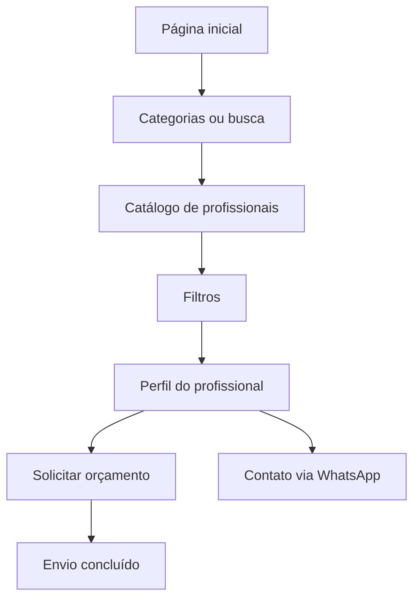

### USER
Me responda em português BR

### ASSISTANT
# Documentação Técnica e de Produto — Manutenção e Serviços

> **Observações importantes**
> - O nome informado na atividade foi **“manutenção e serviços. www”**. Para este documento, considerei **“Manutenção e Serviços”** como nome principal. O trecho “. www” pode ser apenas uma referência incompleta a domínio/endereço. **[A confirmar]**
> - A ideia original menciona **chat privado** e **tabela direcionada para orçamento**. Como essas funcionalidades aumentam a complexidade, este documento propõe um MVP mais simples, com **contato/pedido de orçamento por formulário e/ou WhatsApp**, mantendo o chat como evolução futura.
> - Não foram informados detalhes sobre **cadastro de profissionais, validação dos perfis, moderação de avaliações, pagamento ou área administrativa**. Esses pontos foram tratados como lacunas ou premissas.

---

## 1. Visão Geral do Produto

### 1.1 Descrição da ideia

O site **Manutenção e Serviços** tem como proposta reunir profissionais que realizam serviços de manutenção, consertos, reformas e outros serviços gerais, organizando-os por categoria de atuação. A ideia é que o usuário consiga encontrar prestadores de serviços em **Serra dos Aimorés**, visualizar informações como portfólio, referências, recomendações e críticas, e entrar em contato para solicitar orçamento.

A plataforma funcionaria como um catálogo local de profissionais, permitindo que clientes comparem opções e encontrem prestadores de forma mais segura e organizada. Em uma versão inicial, o foco principal deve ser a divulgação dos profissionais, a organização das informações e o contato entre cliente e prestador.

### 1.2 Problema real identificado

O problema identificado é a dificuldade que as pessoas têm para encontrar profissionais confiáveis para serviços de manutenção em residências, conserto de eletrodomésticos, computadores, celulares, reformas, construções e outros serviços em geral.

Além da dificuldade de localizar esses profissionais, também existe o problema da falta de referências claras. Muitas vezes, o cliente não sabe avaliar previamente a qualidade do serviço, não conhece trabalhos anteriores e não possui um canal simples para conversar com o profissional ou pedir orçamento.

### 1.3 Público-alvo

#### Quem são

Pessoas que precisam realizar serviços como:

- Reformas residenciais;
- Conserto de computadores;
- Conserto de celulares;
- Conserto de eletrodomésticos;
- Construções;
- Manutenção em geral;
- Outros serviços práticos e técnicos.

O foco principal indicado foi a região de **Serra dos Aimorés**.

#### O que precisam

O público precisa de uma forma simples para:

- Encontrar profissionais por tipo de serviço;
- Ver referências e trabalhos anteriores;
- Comparar opções;
- Entrar em contato com o profissional;
- Solicitar orçamento de maneira direta.

#### Que dificuldade enfrentam

As principais dificuldades são:

- Dificuldade para encontrar profissionais qualificados;
- Falta de referências confiáveis;
- Desorganização das informações sobre prestadores de serviço;
- Ausência de um canal simples para contato e orçamento;
- Insegurança na contratação.

#### O que esperam do site

O público espera que o site ofereça:

- Catálogo organizado por categorias;
- Informações claras sobre cada profissional;
- Portfólio ou exemplos de serviços prestados;
- Avaliações, recomendações ou referências;
- Filtro por localidade, categoria e, possivelmente, valor;
- Contato fácil com o profissional.

### 1.4 Proposta de valor

O site será útil porque centraliza profissionais de manutenção e serviços em um único lugar, facilitando a busca por prestadores confiáveis. Em vez de procurar indicações de forma dispersa, o usuário poderá acessar um catálogo organizado, ver portfólios, referências e recomendações, e entrar em contato com mais segurança.

A proposta de valor é: **facilitar a conexão entre pessoas que precisam de serviços de manutenção e profissionais capacitados, organizando informações e aumentando a confiança na contratação.**

### 1.5 Objetivos do site

Os principais objetivos do site são:

- Divulgar profissionais de manutenção e serviços gerais;
- Organizar prestadores por categorias de atuação;
- Facilitar a busca por serviços em Serra dos Aimorés;
- Apresentar portfólios e referências dos profissionais;
- Permitir contato entre cliente e profissional;
- Facilitar pedidos de orçamento;
- Aumentar a visibilidade de prestadores de serviço locais;
- Reduzir a insegurança na contratação de serviços.

### 1.6 Funcionalidades principais

| Funcionalidade | Finalidade | Prioridade |
|---|---|---|
| Catálogo de profissionais | Listar profissionais cadastrados conforme a área de atuação. | Essencial |
| Categorias de serviços | Organizar profissionais por tipo de serviço, como manutenção, conserto, reforma, construção etc. | Essencial |
| Filtros de busca | Permitir busca por localidade, categoria e, se possível, valor. | Essencial |
| Perfil do profissional | Apresentar informações do profissional, área de atuação, portfólio e referências. | Essencial |
| Portfólio de serviços | Mostrar trabalhos realizados pelos profissionais. | Essencial |
| Referências e recomendações | Exibir avaliações, críticas ou indicações de clientes. | Importante |
| Depoimentos em vídeo | Mostrar vídeos de clientes falando sobre serviços prestados. | Importante |
| Contato com profissional | Permitir que o usuário fale com o profissional para tirar dúvidas ou solicitar orçamento. | Essencial |
| Pedido de orçamento | Permitir que o usuário envie informações sobre o serviço desejado. | Essencial |
| Chat privado | Permitir conversa direta entre cliente e profissional. | Futura |
| Cadastro de profissionais | Registrar profissionais e suas áreas de atuação. | Importante |

**Observação:** o chat privado em tempo real é uma funcionalidade mais complexa. Para o MVP, a recomendação técnica é usar um formulário de contato/orçamento e/ou botão de WhatsApp, deixando o chat para uma evolução futura.

### 1.7 Diferencial do site

O diferencial informado é o acesso direto ao profissional e às informações de cada categoria. Isso significa que o site pode se destacar por:

- Reunir profissionais em um único local;
- Facilitar a comparação entre prestadores;
- Mostrar portfólios e referências;
- Dar mais transparência ao processo de contratação;
- Aproximar clientes e profissionais da região.

### 1.8 Como o site ajuda as pessoas

O site pode ajudar as pessoas das seguintes formas:

- Economiza tempo na busca por profissionais;
- Facilita a comunicação entre cliente e prestador;
- Organiza informações sobre serviços e profissionais;
- Aumenta a visibilidade de profissionais locais;
- Ajuda o cliente a tomar decisões com mais segurança;
- Permite visualizar trabalhos anteriores por meio de portfólios;
- Oferece referências e recomendações em um só lugar;
- Reduz a dificuldade de encontrar serviços de manutenção.

### 1.9 Conteúdo da página inicial

Com base nas respostas fornecidas, a página inicial pode conter:

- Título principal apresentando o site;
- Breve explicação sobre a proposta do site;
- Campo ou botão de busca por profissionais;
- Categorias de serviços;
- Profissionais em destaque;
- Portfólios de serviços prestados;
- Referências e recomendações de clientes;
- Depoimentos em vídeo, se disponíveis;
- Chamada para ação, como “Encontrar profissional” ou “Solicitar orçamento”;
- Rodapé com contato, aviso de privacidade e links principais.

**Sugestão técnica:** como o site terá foco local, é recomendado destacar a cidade **Serra dos Aimorés** logo na página inicial, deixando claro para o usuário que o serviço é voltado para aquela região.

### 1.10 Premissas, lacunas e decisões de escopo

#### Informações fornecidas pelo aluno

- Nome do site;
- Problema a ser resolvido;
- Público-alvo;
- Funcionamento geral da plataforma;
- Funcionalidades principais;
- Diferencial do site;
- Benefícios para as pessoas;
- Conteúdo esperado para a página inicial.

#### Informações ausentes ou vagas

- O nome exato do domínio ou se “. www” faz parte do nome final. **[A confirmar]**
- Como será feito o cadastro dos profissionais. **[Informação ausente]**
- Se os profissionais terão autonomia para editar seus próprios perfis. **[Informação ausente]**
- Como as recomendações e críticas serão moderadas ou verificadas. **[Informação ausente]**
- Quais campos farão parte da tabela de orçamento. **[A confirmar]**
- Se haverá filtro por faixa de valor e como esse valor será definido. **[A confirmar]**
- Se haverá login para clientes e profissionais. **[Informação ausente]**
- Se o site terá pagamento integrado. **[Informação ausente]**
- Se o chat privado será em tempo real ou apenas uma troca simples de mensagens. **[A confirmar]**

#### Premissas assumidas pela IA

- **Premissa assumida:** o MVP será focado em catálogo público de profissionais, com páginas de perfil e contato/orçamento.
- **Premissa assumida:** o chat privado em tempo real não será implementado na primeira versão para manter o projeto simples.
- **Premissa assumida:** o cadastro inicial dos profissionais poderá ser feito de forma simplificada, sem painel administrativo completo.
- **Premissa assumida:** o site será inicialmente voltado para Serra dos Aimorés e região.
- **Premissa assumida:** o contato poderá ser feito por formulário e/ou botão de WhatsApp, dependendo da informação disponibilizada pelo profissional.

#### Recomendações técnicas adicionadas

- **Sugestão técnica:** usar formulário de orçamento em vez de chat privado no MVP.
- **Sugestão técnica:** usar vídeos externos, como YouTube ou Vimeo, para reduzir necessidade de armazenamento próprio.
- **Sugestão técnica:** validar todos os dados enviados por formulários.
- **Sugestão técnica:** exibir mensagens claras de sucesso e erro.
- **Sugestão técnica:** incluir aviso de privacidade quando houver coleta de dados de contato.

#### O que ficou fora do escopo para manter o projeto simples

- Pagamento online;
- Aplicativo mobile nativo;
- Painel administrativo completo;
- Sistema complexo de chat em tempo real;
- Integração com inteligência artificial;
- Relatórios avançados;
- Sistema financeiro;
- Multiplos bancos de dados;
- Arquitetura de microserviços.

---

## 2. Arquitetura da Informação

### 2.1 Mapa de páginas

| Página | Rota sugerida | Objetivo | Público principal | Conteúdo principal | Ações do usuário | Prioridade |
|---|---|---|---|---|---|---|
| Início | `/` | Apresentar o site e facilitar o acesso ao catálogo. | Clientes e visitantes. | Apresentação, categorias, profissionais em destaque, portfólios e depoimentos. | Buscar profissional, acessar categorias. | Essencial |
| Catálogo de profissionais | `/profissionais` | Listar profissionais disponíveis. | Clientes. | Cards de profissionais, filtros por categoria, localidade e valor. | Filtrar, ordenar e abrir perfil. | Essencial |
| Perfil do profissional | `/profissionais/[id]` | Detalhar informações de um profissional. | Clientes. | Foto, descrição, categoria, portfólio, referências, recomendações e contato. | Ver portfólio, ler avaliações, solicitar orçamento. | Essencial |
| Contato e orçamento | `/orcamento` | Permitir que o usuário envie um pedido de orçamento. | Clientes. | Formulário com nome, contato, descrição do serviço e profissional desejado. | Preencher e enviar formulário. | Essencial |
| Como funciona | `/como-funciona` | Explicar o uso do site. | Visitantes. | Passo a passo para encontrar profissional e solicitar orçamento. | Entender o funcionamento. | Importante |
| Cadastro de profissional | `/cadastro-profissional` | Permitir que profissionais manifestem interesse em participar do catálogo. | Profissionais. | Formulário simples com dados básicos do profissional. | Enviar dados para avaliação/cadastro. | Futura |

### 2.2 Fluxo principal de navegação

O fluxo principal esperado é:

1. O usuário acessa a página inicial;
2. Entende a proposta do site;
3. Busca por uma categoria ou profissional;
4. Aplica filtros, como cidade ou tipo de serviço;
5. Visualiza a lista de profissionais;
6. Abre o perfil de um profissional;
7. Vê portfólio, referências e recomendações;
8. Entra em contato ou solicita orçamento;
9. Recebe confirmação de envio ou é direcionado para WhatsApp.

Representação simples do fluxo:



### 2.3 Organização do conteúdo

Os conteúdos do site devem ser organizados da seguinte forma:

#### Conteúdo institucional

- Apresentação do site;
- Como funciona;
- Contato;
- Aviso de privacidade;
- Informações sobre a região atendida.

#### Conteúdo dos profissionais

- Nome do profissional ou nome do negócio;
- Categoria de atuação;
- Descrição do serviço;
- Cidade ou região de atendimento;
- Foto ou logo;
- Portfólio;
- Referências;
- Recomendações;
- Críticas, quando existirem;
- Forma de contato.

#### Conteúdo de busca e filtros

- Categoria do serviço;
- Localidade, especialmente Serra dos Aimorés;
- Faixa de valor, se disponível;
- Ordem de exibição, como mais recentes ou melhor avaliados.

#### Conteúdo de depoimentos

- Depoimentos escritos de clientes;
- Vídeos de clientes recomendando serviços;
- Avaliações ou comentários.

#### Conteúdo de contato/orçamento

- Nome do cliente;
- Telefone ou WhatsApp;
- E-mail, se necessário;
- Descrição do serviço desejado;
- Profissional selecionado, quando houver;
- Mensagem ou observações.

### 2.4 Estados e mensagens importantes

O site deve tratar os seguintes estados e mensagens:

| Estado | Mensagem ou comportamento recomendado |
|---|---|
| Formulário enviado com sucesso | “Seu pedido de orçamento foi enviado com sucesso.” |
| Erro ao enviar formulário | “Não foi possível enviar sua solicitação. Tente novamente.” |
| Campo obrigatório não preenchido | “Preencha este campo antes de continuar.” |
| Nenhum profissional encontrado | “Nenhum profissional encontrado para essa busca. Tente outro filtro.” |
| Página em carregamento | Exibir indicador visual de carregamento. |
| Perfil de profissional indisponível | “Profissional não encontrado ou indisponível.” |
| Imagem indisponível | Exibir imagem alternativa padrão. |
| Vídeo indisponível | Exibir aviso ou esconder o bloco do vídeo. |
| Contato via WhatsApp indisponível | Exibir alternativa de formulário. |

### 2.5 Requisitos de experiência do usuário

O site deve seguir estas orientações de UX:

- Navegação simples e clara;
- Botões visíveis para “Buscar profissional” e “Solicitar orçamento”;
- Textos objetivos e fáceis de entender;
- Layout responsivo para celular, tablet e computador;
- Boa hierarquia visual, destacando informações importantes;
- Informações principais acima da dobra;
- Filtros fáceis de usar;
- Cartões de profissionais com informações resumidas;
- Formulários curtos;
- Acessibilidade básica, como bom contraste, rótulos nos campos e textos alternativos em imagens;
- Mensagens de erro claras;
- Feedback visual após ações do usuário.

---

## 3. Stack Tecnológica Sugerida

### 3.1 Critérios de escolha

A stack foi escolhida com base nos seguintes critérios:

- Simplicidade para alunos iniciantes;
- Facilidade de aprendizado;
- Baixo custo inicial;
- Facilidade de publicação;
- Manutenção simples;
- Adequação ao escopo do projeto;
- Possibilidade de evoluir o site no futuro;
- Uso de tecnologias consolidadas e com boa documentação.

Como o projeto envolve catálogo de profissionais, perfis, filtros, portfólios e formulário de contato/orçamento, é recomendável usar uma solução com banco de dados simples. Ainda assim, a proposta evita recursos complexos desnecessários.

### 3.2 Recomendação principal

| Camada | Tecnologia sugerida | Motivo |
|---|---|---|
| Frontend | Next.js | Facilita criação de páginas, rotas e componentes. É moderno, bem documentado e permite começar simples. |
| Estilo | CSS puro | Simples para estudantes, evita dependências desnecessárias e permite aprender fundamentos de layout. |
| Backend | Supabase | Oferece banco de dados, autenticação opcional, armazenamento de arquivos e API simples. |
| Banco de dados | PostgreSQL no Supabase | Banco de dados gerenciado, adequado para catalogar profissionais, portfólios e pedidos de orçamento. |
| Autenticação | Sem autenticação no MVP; Supabase Auth como evolução futura | No MVP, o site pode funcionar com catálogo público e contato simples. Login pode ser adicionado depois. |
| Hospedagem | Vercel | Boa integração com Next.js, facilidade de deploy e plano inicial acessível. |
| Formulários ou contato | Formulário próprio salvando dados no Supabase e/ou link para WhatsApp | Permite registrar pedidos de orçamento e também oferecer contato direto. |
| Versionamento | Git e GitHub | Permite salvar o histórico do projeto, organizar mudanças e facilitar o trabalho em equipe. |

### 3.3 Diretrizes de stack conforme complexidade

Para este projeto, a recomendação é:

- Criar um site com catálogo dinâmico de profissionais;
- Usar banco de dados para armazenar profissionais, categorias, portfólios e pedidos de orçamento;
- Não implementar pagamento online nesta fase;
- Não implementar chat em tempo real no MVP;
- Não criar painel administrativo complexo inicialmente;
- Usar formulário simples para contato/orçamento;
- Permitir que o contato direto seja feito por WhatsApp, quando o profissional disponibilizar;
- Deixar login, área do profissional e chat privado como evoluções futuras.

Essa escolha mantém o projeto viável para estudantes e evita transformar a ideia em uma plataforma complexa demais.

### 3.4 O que evitar

Para manter o projeto simples e adequado ao nível de aprendizado, deve-se evitar:

- Microserviços;
- Docker ou Kubernetes;
- Múltiplos bancos de dados;
- GraphQL se uma API simples for suficiente;
- Infraestrutura complexa;
- Soluções corporativas pesadas;
- Aplicativo mobile nativo, já que um site responsivo resolve o MVP;
- Blockchain;
- Sistemas de inteligência artificial complexos;
- Payment gateway sem necessidade clara;
- Chat em tempo real antes de validar a versão básica do site.

### 3.5 Serviços e integrações

Integrações recomendadas ou possíveis:

| Serviço | Uso no projeto |
|---|---|
| WhatsApp | Permitir contato direto com o profissional, quando disponível. |
| Supabase Storage | Armazenar imagens de perfil e fotos de portfólio, se necessário. |
| YouTube ou Vimeo | Incorporar vídeos de depoimentos sem precisar armazenar os vídeos no próprio servidor. |
| E-mail | Envio de confirmações ou notificações futuras. |
| Formulário de contato | Registrar pedidos de orçamento ou solicitações de cadastro. |
| Mapa | Futuramente, para mostrar localização ou área de atendimento. |
| Autenticação | Futuramente, se houver área do profissional. |

### 3.6 Hospedagem e deploy

Para este projeto, a recomendação principal é:

- **Vercel** para hospedagem do frontend Next.js;
- **Supabase** para banco de dados, armazenamento e eventuais serviços de backend.

Alternativas que podem ser consideradas no futuro:

- Netlify, se o projeto for simplificado para frontend estático;
- Render ou Railway, caso se opte por um backend Node.js/Express separado.

Para o MVP, **Vercel + Supabase** é a combinação mais simples e coerente.

### 3.7 Segurança e boas práticas mínimas

Recomendações importantes:

- Validar dados no frontend e também no backend;
- Não expor chaves de API no código visível ao usuário;
- Usar HTTPS;
- Limitar a coleta de dados ao mínimo necessário;
- Exibir mensagens claras de erro;
- Proteger formulários contra envio indevido;
- Não permitir que qualquer usuário edite dados de profissionais sem permissão;
- Usar políticas de segurança no Supabase, como Row Level Security, quando aplicável;
- Ter cuidado com exibição pública de telefone, WhatsApp e imagens;
- Solicitar consentimento para uso de depoimentos e imagens;
- Incluir aviso simples de privacidade se o site coletar nome, telefone ou mensagens.

---

## 4. Estrutura de Pastas e Boas Práticas

### 4.1 Estrutura de pastas sugerida

Estrutura recomendada para um projeto Next.js com Supabase:

```txt
projeto/
├─ public/
│  ├─ favicon.ico
│  └─ imagens/
│
├─ src/
│  ├─ app/
│  │  ├─ layout.js
│  │  ├─ page.js
│  │  ├─ profissionais/
│  │  │  ├─ page.js
│  │  │  └─ [id]/
│  │  │     └─ page.js
│  │  ├─ orcamento/
│  │  │  └─ page.js
│  │  └─ como-funciona/
│  │     └─ page.js
│  │
│  ├─ components/
│  │  ├─ Header.jsx
│  │  ├─ Footer.jsx
│  │  ├─ CardProfissional.jsx
│  │  ├─ FiltroProfissionais.jsx
│  │  ├─ FormOrcamento.jsx
│  │  ├─ GaleriaPortfolio.jsx
│  │  └─ DepoimentoVideo.jsx
│  │
│  ├─ lib/
│  │  ├─ supabase.js
│  │  └─ validacoes.js
│  │
│  ├─ services/
│  │  ├─ profissionais.service.js
│  │  ├─ categorias.service.js
│  │  └─ orcamentos.service.js
│  │
│  ├─ styles/
│  │  └─ globals.css
│  │
│  └─ types/
│     └─ profissional.js
│
├─ .env.local.example
├─ .gitignore
├─ package.json
└─ README.md
```

### 4.2 Separação de responsabilidades

Para manter o código organizado, é importante separar as responsabilidades:

#### Estrutura visual

Arquivos `.jsx` ou `.js` dentro de `app/` e `components/` devem cuidar da estrutura das telas, como cabeçalho, rodapé, cartões e formulários.

#### Estilo

Arquivos CSS devem cuidar apenas da aparência: cores, espaçamentos, fontes, responsividade e alinhamentos.

#### Componentes reutilizáveis

Componentes como `Header`, `Footer`, `CardProfissional` e `FormOrcamento` devem ser criados para evitar repetição de código.

#### Serviços

A pasta `services/` deve conter funções que buscam ou enviam dados, como listar profissionais ou salvar um pedido de orçamento.

#### Biblioteca e configurações

A pasta `lib/` pode conter configurações do Supabase, validações e funções utilitárias.

#### Dados

Dados vindos do banco devem ser tratados de forma organizada, evitando consultas espalhadas diretamente nos componentes visuais.

#### Regras de negócio

Regras como validação de campos, filtros e permissões devem ficar separadas da interface sempre que possível.

### 4.3 Convenções recomendadas

- Usar nomes de arquivos claros e objetivos;
- Nomear componentes com inicial maiúscula, por exemplo: `CardProfissional.jsx`;
- Usar rotas em minúsculas, por exemplo: `/profissionais`;
- Separar páginas, componentes, serviços e estilos;
- Usar comentários apenas quando necessário;
- Manter funções pequenas e fáceis de entender;
- Evitar arquivos muito grandes;
- Padronizar nomes de variáveis e funções em português claro ou inglês simples.

Exemplos:

```txt
obterProfissionais()
obterProfissionalPorId()
enviarPedidoOrcamento()
validarFormularioOrcamento()
```

### 4.4 Boas práticas de código

- Evitar repetição de código;
- Separar conteúdo, estilo e lógica;
- Validar entradas do usuário;
- Manter o código legível;
- Usar HTML semântico corretamente;
- Priorizar acessibilidade;
- Testar o layout em diferentes tamanhos de tela;
- Versionar o código com Git;
- Não salvar dados sensíveis diretamente no código;
- Tratar erros de carregamento e envio de dados;
- Usar mensagens claras para o usuário.

### 4.5 Boas práticas de produto

- Página inicial clara e objetiva;
- Chamada para ação visível;
- Informações essenciais fáceis de encontrar;
- Navegação simples;
- Textos curtos e compreensíveis;
- Layout responsivo;
- Bom contraste visual;
- Formulários curtos;
- Destaque para profissionais e categorias principais;
- Filtros fáceis de usar;
- Feedback visual após envio de formulário;
- Rodapé com informações importantes.

### 4.6 O que evitar no código

Evite:

- Arquivos muito grandes e desorganizados;
- Lógica espalhada sem padrão;
- Dependências desnecessárias;
- Excesso de bibliotecas;
- Páginas confusas com muitas informações;
- Código sem comentários ou com nomes pouco claros;
- Consultas ao banco diretamente em vários componentes sem organização;
- Exposição desnecessária de dados pessoais;
- Formulários longos demais;
- Funcionalidades avançadas antes do MVP estar funcionando.

---

## 5. Plano de Ação (Passo a Passo)

### Etapa 0 — Organização inicial

**Objetivo:** preparar o projeto antes de escrever código.

**O que fazer:**

- Revisar a ideia do site;
- Confirmar o nome final do site;
- Definir as páginas principais;
- Listar os textos iniciais;
- Separar imagens, logos e possíveis depoimentos;
- Criar um repositório no GitHub ou uma pasta organizada do projeto;
- Definir a estrutura inicial de pastas;
- Escolher as tecnologias do MVP.

**Entregável esperado:** uma descrição curta do projeto, lista de páginas e repositório/pasta inicial criada.

**Critério de conclusão:** o aluno deve conseguir explicar em poucas frases o que o site faz, quais páginas existirão e qual será a stack utilizada.

---

### Etapa 1 — Modelagem e dados

**Objetivo:** pensar nas informações que o site vai usar.

**O que fazer:**

- Definir quais dados serão exibidos no catálogo;
- Listar entidades principais;
- Definir campos necessários;
- Decidir onde os dados ficarão armazenados;
- Criar dados de exemplo para testes.

**Entidades possíveis:**

#### Profissional

Campos possíveis:

- `id`;
- `nome`;
- `categoria`;
- `descricao`;
- `cidade`;
- `bairro`;
- `telefone_whatsapp`;
- `foto_url`;
- `ativo`;
- `data_criacao`.

#### Categoria

Campos possíveis:

- `id`;
- `nome`;
- `descricao`.

#### Portfólio

Campos possíveis:

- `id`;
- `profissional_id`;
- `titulo`;
- `descricao`;
- `imagem_url`.

#### Avaliação ou referência

Campos possíveis:

- `id`;
- `profissional_id`;
- `nome_cliente`;
- `comentario`;
- `nota`;
- `data`;
- `status_moderação`. **[A confirmar]**

#### Pedido de orçamento

Campos possíveis:

- `id`;
- `nome_cliente`;
- `telefone`;
- `email`;
- `profissional_id`;
- `descricao_servico`;
- `mensagem`;
- `data_envio`.

**Entregável esperado:** modelo de dados simples, com tabelas e campos definidos.

**Critério de conclusão:** o aluno deve conseguir listar quais informações serão armazenadas e onde cada campo será usado.

---

### Etapa 2 — Backend ou regras de negócio

**Objetivo:** definir a lógica necessária para o funcionamento do site.

**O que fazer:**

- Criar projeto no Supabase;
- Criar tabelas principais;
- Inserir dados de exemplo;
- Definir regras de leitura pública para profissionais ativos;
- Definir regra para salvar pedidos de orçamento;
- Validar campos obrigatórios;
- Definir limites para imagens e textos;
- Preparar permissões mínimas de segurança.

**Operações principais:**

- Listar profissionais ativos;
- Buscar profissional por ID;
- Listar categorias;
- Listar portfólio de um profissional;
- Listar referências de um profissional;
- Salvar pedido de orçamento;
- Salvar solicitação de cadastro de profissional, se essa funcionalidade for mantida.

**Regras de validação sugeridas:**

- Nome do cliente é obrigatório;
- Telefone ou WhatsApp é obrigatório;
- Descrição do serviço é obrigatória;
- Telefone deve ter formato válido;
- Mensagem não pode ser excessivamente longa;
- Imagens devem ter tamanho limitado.

**Entregável esperado:** banco de dados configurado com tabelas, dados de teste e regras básicas de segurança.

**Critério de conclusão:** o aluno deve conseguir ler profissionais do banco e salvar um pedido de orçamento de teste.

---

### Etapa 3 — Frontend base

**Objetivo:** criar a estrutura visual do site.

**O que fazer:**

- Criar layout principal;
- Criar cabeçalho;
- Criar menu de navegação;
- Criar rodapé;
- Criar página inicial básica;
- Criar componentes reutilizáveis;
- Definir cores, fontes e espaçamentos;
- Garantir responsividade básica.

**Componentes sugeridos:**

- `Header`;
- `Footer`;
- `CardProfissional`;
- `FiltroProfissionais`;
- `FormOrcamento`;
- `GaleriaPortfolio`;
- `DepoimentoVideo`.

**Entregável esperado:** estrutura visual navegável, mesmo que ainda sem dados reais.

**Critério de conclusão:** as páginas devem abrir corretamente, com menu funcionando e layout adaptável para celular.

---

### Etapa 4 — Páginas principais

**Objetivo:** construir as páginas definidas na arquitetura da informação.

#### Página inicial

O que fazer:

- Criar título principal;
- Apresentar a proposta do site;
- Exibir categorias;
- Exibir profissionais em destaque;
- Exibir depoimentos ou vídeos;
- Incluir botão para catálogo.

#### Catálogo de profissionais

O que fazer:

- Listar profissionais;
- Exibir filtros;
- Permitir busca por categoria;
- Permitir filtro por localidade;
- Exibir cartões com nome, categoria, cidade e botão para ver perfil.

#### Perfil do profissional

O que fazer:

- Exibir foto ou logo;
- Exibir nome e categoria;
- Exibir descrição;
- Exibir portfólio;
- Exibir referências e recomendações;
- Exibir botão de contato ou orçamento.

#### Página de orçamento

O que fazer:

- Criar formulário com campos essenciais;
- Validar campos obrigatórios;
- Permitir seleção do profissional, quando aplicável;
- Exibir mensagem de sucesso após envio;
- Exibir mensagem de erro quando necessário.

#### Página como funciona

O que fazer:

- Explicar passo a passo;
- Mostrar como o usuário encontra profissional;
- Mostrar como solicitar orçamento;
- Usar linguagem simples.

**Entregável esperado:** páginas principais construídas e navegáveis.

**Critério de conclusão:** o usuário deve conseguir acessar a página inicial, abrir o catálogo, entrar em um perfil e acessar a página de orçamento.

---

### Etapa 5 — Integração entre frontend e backend

**Objetivo:** conectar interface e dados.

**O que fazer:**

- Buscar profissionais do Supabase;
- Buscar categorias do Supabase;
- Buscar portfólios e referências;
- Exibir profissionais dinamicamente;
- Aplicar filtros com base nos dados;
- Enviar pedidos de orçamento para o banco;
- Tratar estados de carregamento;
- Tratar erros de conexão;
- Exibir mensagens de sucesso;
- Configurar botão de WhatsApp, quando houver número disponível.

**Estados importantes:**

- Carregando lista;
- Lista carregada com sucesso;
- Nenhum profissional encontrado;
- Erro ao carregar dados;
- Enviando formulário;
- Formulário enviado com sucesso;
- Erro ao enviar formulário.

**Entregável esperado:** site consumindo dados do banco e salvando pedidos de orçamento.

**Critério de conclusão:** ao acessar o catálogo, os profissionais devem ser carregados do banco. Ao enviar o formulário, o pedido deve ser registrado corretamente.

---

### Etapa 6 — Testes e ajustes

**Objetivo:** validar o funcionamento do site.

**O que fazer:**

- Testar navegação entre páginas;
- Testar filtros;
- Testar busca;
- Testar formulário de orçamento;
- Testar envio com campos vazios;
- Testar mensagens de erro;
- Testar mensagens de sucesso;
- Testar responsividade em celular, tablet e computador;
- Verificar textos e ortografia;
- Verificar imagens quebradas;
- Testar links de WhatsApp;
- Verificar contraste e acessibilidade básica.

**Entregável esperado:** versão ajustada e estável do MVP.

**Critério de conclusão:** o fluxo principal deve funcionar sem erros graves: encontrar profissional, abrir perfil e enviar pedido de orçamento.

---

### Etapa 7 — Publicação

**Objetivo:** colocar o site no ar.

**O que fazer:**

- Criar conta na Vercel;
- Conectar o repositório GitHub;
- Configurar variáveis de ambiente do Supabase;
- Fazer deploy do projeto;
- Verificar se o site carregou corretamente;
- Testar formulário em produção;
- Verificar HTTPS;
- Testar versão publicada em diferentes dispositivos.

**Entregável esperado:** site publicado em uma URL pública.

**Critério de conclusão:** o site deve estar acessível online, com páginas principais funcionando e formulário operacional.

---

### Etapa 8 — Próximas evoluções

**Objetivo:** listar melhorias futuras, sem torná-las obrigatórias para o MVP.

**Melhorias possíveis:**

- Área de login para profissionais;
- Edição de perfil pelo próprio profissional;
- Chat privado entre cliente e profissional;
- Sistema de avaliações com moderação;
- Painel simples para aprovação de cadastros;
- Filtro por faixa de valor mais detalhado;
- Mapa com área de atendimento;
- Notificações por e-mail;
- Página de perguntas frequentes;
- Relatórios simples de contatos recebidos;
- Integração com WhatsApp mais estruturada;
- Versão para outras cidades.

Essas evoluções devem ser implementadas somente após o MVP básico estar funcionando e validado.